<div align="center">
<picture>
  <source media="(prefers-color-scheme: dark)" srcset=".github/brand/banner-night.svg">
  
</picture>
<br><br>
<a href="#structure"><picture><source media="(prefers-color-scheme: dark)" srcset=".github/brand/tab-structure-night.svg"></picture></a>
<a href="#loading-order"><picture><source media="(prefers-color-scheme: dark)" srcset=".github/brand/tab-loading-order-night.svg"></picture></a>
<a href="#installation"><picture><source media="(prefers-color-scheme: dark)" srcset=".github/brand/tab-installation-night.svg"></picture></a>
<a href="#dependencies"><picture><source media="(prefers-color-scheme: dark)" srcset=".github/brand/tab-dependencies-night.svg"></picture></a>
<a href="#customization"><picture><source media="(prefers-color-scheme: dark)" srcset=".github/brand/tab-customization-night.svg"></picture></a>
<a href="#license"><picture><source media="(prefers-color-scheme: dark)" srcset=".github/brand/tab-license-night.svg"></picture></a>
</div>

<br>

A modular, macOS-focused Zsh configuration. The monolithic `.zshrc` is split into small, single-purpose modules that the loader sources in dependency order, so each piece of functionality lives in its own file and is easy to find, edit, or disable.

> **Note:** This config is written for **macOS**. It assumes Homebrew, and several modules use Mac-only tooling (`osascript`, `pbpaste`/`pbcopy`, `diskutil`, BSD `sed`). It will _load_ on Linux thanks to `command -v` guards on most external tools, but the Mac-specific aliases and functions won't work there.

<p>
<a name="structure"></a>
<picture><source media="(prefers-color-scheme: dark)" srcset=".github/brand/section-structure-night.svg"></picture>
</p>

```
~/.config/zsh/
├── .zshrc              # loader — sources all modules in order
├── aliases/
│   ├── development.zsh # compilers, npm, build tools
│   ├── git.zsh         # iskra + project navigation
│   ├── multimedia.zsh  # AI models, Apple Music, misc
│   └── system.zsh      # ls/eza, editor shortcuts, system
├── core/
│   ├── completion.zsh  # completion styling
│   ├── environment.zsh # core env vars + zsh behavior
│   └── oh-my-zsh.zsh   # Oh My Zsh + plugin list
├── exports/
│   ├── libraries.zsh   # library/header paths (macOS)
│   └── paths.zsh       # PATH management
├── external/
│   ├── completions.zsh # python argcomplete hooks
│   ├── conda.zsh       # conda init
│   └── tools.zsh       # fzf, atuin, zoxide, etc. (guarded)
├── functions/
│   ├── arduino.zsh     # arduino-cli compile/upload helpers
│   ├── files.zsh       # yazi, batcopy, repo jumper
│   ├── gh.zsh          # gh CLI completion
│   ├── homebrew.zsh    # brew browser, sketchybar control
│   └── misc.zsh        # onefetch, dynamic web aliases
├── hooks/
│   └── directory.zsh   # chpwd hooks
├── local.zsh           # machine-specific overrides (gitignored)
└── README.md
```

<p>
<a name="loading-order"></a>
<picture><source media="(prefers-color-scheme: dark)" srcset=".github/brand/section-loading-order-night.svg"></picture>
</p>

The loader (`.zshrc`) sources modules in dependency order: **core** (environment, Oh My Zsh, completion) → **exports** (PATH, libraries) → **aliases** → **functions** → **hooks** → **external** tools. Anything that defines values others depend on loads first.

After the tracked modules, the loader sources two optional, untracked files if they exist:

- `local.zsh` — machine-specific settings that shouldn't be committed
- `~/.secrets.env` — API keys and secrets, kept out of the repo

<p>
<a name="installation"></a>
<picture><source media="(prefers-color-scheme: dark)" srcset=".github/brand/section-installation-night.svg"></picture>
</p>

Clone directly into your Zsh config directory:

```sh
git clone https://github.com/NoamFav/zsh.git ~/.config/zsh
```

Then point `~/.zshrc` at the loader. The simplest approach is a symlink so edits to the repo are picked up live:

```sh
ln -sf ~/.config/zsh/.zshrc ~/.zshrc
```

Reload:

```sh
source ~/.zshrc
```

<p>
<a name="dependencies"></a>
<picture><source media="(prefers-color-scheme: dark)" srcset=".github/brand/section-dependencies-night.svg"></picture>
</p>

The config is built around a modern CLI toolset. Most external tools are guarded with `command -v`, so missing ones are skipped rather than throwing errors — but you'll get the intended experience only with them installed.

**Core:** [Oh My Zsh](https://ohmyz.sh/) with `zsh-syntax-highlighting`, `zsh-autosuggestions`, `zsh-completions`, and `fzf-tab`.

**Recommended tools** (install via Homebrew):

- [`eza`](https://github.com/eza-community/eza) — modern `ls`
- [`btop`](https://github.com/aristocratos/btop) — system monitor
- [`fzf`](https://github.com/junegunn/fzf) — fuzzy finder
- [`zoxide`](https://github.com/ajeetdsouza/zoxide) — smart `cd`
- [`atuin`](https://github.com/atuinsh/atuin) — shell history
- [`bat`](https://github.com/sharkdp/bat) — `cat` with highlighting
- [`fastfetch`](https://github.com/fastfetch-cli/fastfetch) / [`onefetch`](https://github.com/o2sh/onefetch) — system / repo info
- [`yazi`](https://github.com/sxyazi/yazi) — terminal file manager
- [`fd`](https://github.com/sharkdp/fd) — modern `find`

**Optional / context-specific:** `arduino-cli` + `jq` (Arduino helpers), `oh-my-posh` (prompt), `thefuck` (command correction), `lazygit`.

<p>
<a name="customization"></a>
<picture><source media="(prefers-color-scheme: dark)" srcset=".github/brand/section-customization-night.svg"></picture>
</p>

- **Machine-specific settings** → put them in `local.zsh`. It's gitignored and sourced automatically if present, so it won't be overwritten and won't pollute the repo.
- **Module changes** → edit the relevant file directly; each is self-contained.
- **New modules** → create the file in the appropriate folder and add its path to the `ZSH_MODULES` array in `.zshrc`.

<p>
<a name="license"></a>
<picture><source media="(prefers-color-scheme: dark)" srcset=".github/brand/section-license-night.svg"></picture>
</p>

MIT

<br>

<a href="https://nf-software.com">
<picture>
  <source media="(prefers-color-scheme: dark)" srcset=".github/brand/footer-night.svg">
  
</picture>
</a>
